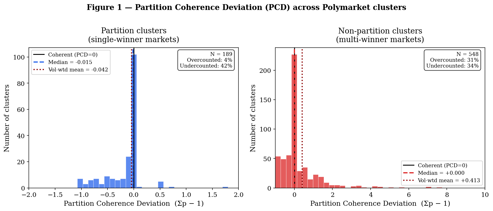
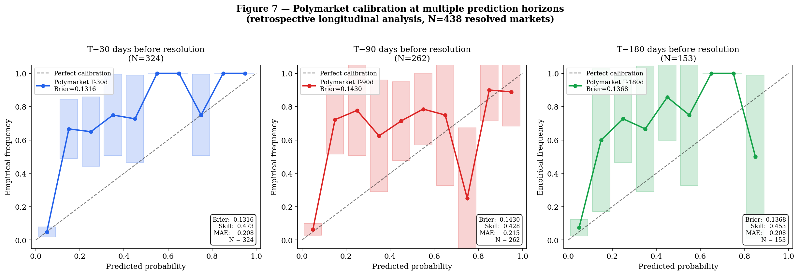

# Are Prediction Markets Bayesian-Coherent? Evidence from Polymarket

Working paper and full replication code.
**[Read the paper (PDF)](paper/main.pdf)**

## Abstract (short)
We test whether prediction markets achieve *Bayesian coherence*: the joint distribution implied by
all related contract prices should satisfy the axioms of probability. Using a snapshot of
**200,351 Polymarket contracts** (April 2026), we introduce the **Partition Coherence Deviation**
(PCD = sum of prices − 1) and measure it on **737 clusters** of related markets.

## Key results
- **Partition clusters** (single winner): volume-weighted PCD of **−4.2 %**, a systematic
  undercounting worth about 4 cents per dollar across all outcomes.
- **Non-partition clusters**: volume-weighted PCD of **+41.3 %**; the ten largest violations cover
  about $60 million of volume.
- **Calibration**: on 421 resolved markets, Brier score of **0.128–0.148** at every horizon,
  better than published superforecaster benchmarks (≈ 0.15), with accuracy peaking at T−60 days.
- **Framework**: *Bayesian Market Efficiency* (BME), which nests the standard EMH as a special
  case; limits to arbitrage (platform risk, coordination costs) explain why violations persist.

| PCD distribution | Calibration by horizon |
|---|---|
|  |  |

## Replication
```bash
python data/collect_polymarket.py      # raw snapshot (large, not versioned)
python data/build_clusters.py
python data/full_analysis.py
python data/analysis_longitudinal.py
python data/generate_figures.py
```
Raw data (≈ 1.3 GB) is not included; the scripts download it from the public Polymarket APIs.
Summary results are in `data/*.json`.
